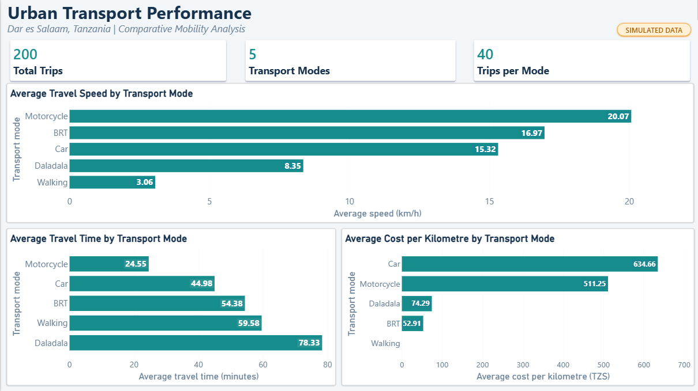
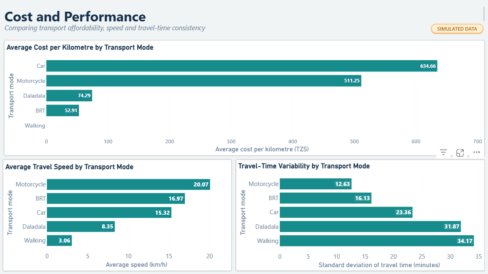
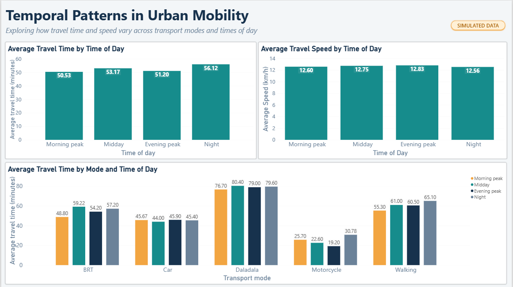

# Exploring Urban Transport Performance Through Data

### Travel Speed, Cost and Temporal Patterns Using Simulated Data

**Geographical Context:** Dar es Salaam, Tanzania

## Project Overview

This project explores and compares the performance of five selected urban transport modes: Bus Rapid Transit (BRT), daladala, motorcycles, private cars and walking.

Using a simulated dataset of 200 trip records, the project examines differences in travel speed, travel cost, travel-time variability and travel patterns across different times of the day.

The project demonstrates how SQL and business intelligence tools can be applied to organise, analyse and communicate urban mobility data.

**Important:** The dataset is simulated and does not represent actual transport observations from Dar es Salaam. The findings are illustrative and intended for learning and exploratory analysis.

## Research Question

How do selected urban transport modes compare in terms of travel speed, cost per kilometre and travel-time variability, and how do their travel patterns differ across various times of the day?

## Project Objectives

- Compare average travel speed across the selected transport modes.
- Evaluate average trip cost and average cost per kilometre.
- Examine the relationship between travel speed and travel cost.
- Assess differences in travel-time variability.
- Explore variations in travel time and speed across different times of the day.
- Identify dataset limitations and opportunities for further analysis.

## Dataset

The dataset contains 200 simulated trip records, with 40 records for each transport mode.

Key variables include:

- Transport mode
- Trip distance
- Travel time
- Trip cost
- Trip date
- Time of day
- Traffic condition

## Tools and Technologies

- **PostgreSQL:** Data storage, preparation and SQL-based analysis.
- **SQL:** Data querying, aggregation and calculation.
- **Microsoft Power BI:** Data analysis, visualisation and dashboard development.

## Key Findings

- Motorcycles recorded the highest average travel speed.
- BRT recorded the lowest average cost per kilometre among paid transport modes.
- Daladala recorded the longest average travel time.
- Walking and daladala exhibited the greatest travel-time variability, measured using sample standard deviation.
- Average travel times differed across the four time periods examined.

These findings describe the simulated dataset and should not be interpreted as actual transport performance in Dar es Salaam.

## Project Structure

| Folder | Contents |
|---|---|
| `report/` | Final project report in PDF format |
| `sql/` | SQL script for dataset creation, preparation and analysis |
| `dashboard/` | Power BI dashboard file |
| `images/` | Dashboard screenshots and project visuals |

## Project Outputs

The complete project deliverables are available below:

| Deliverable | Description |
|---|---|
| [Project Report (PDF)](report/urban_mobility_analysis_report.pdf) | Complete written report documenting the methodology, findings and conclusions |
| [SQL Analysis Script](sql/mobility_analysis_cleaned.sql) | SQL code for dataset creation, preparation, quality checks and analysis |
| [Power BI Dashboard](dashboard/Dar_es_Salaam_Urban_Mobility_Dashboard.pbix) | Interactive three-page dashboard |
| [Dashboard Screenshots](images/) | Static previews of the dashboard pages |

## Dashboard Preview

The Power BI dashboard presents the results through three pages.

### 1. Transport Performance Overview

### 2. Cost and Performance

### 3. Temporal Patterns in Urban Mobility

To explore the interactive dashboard, download the [Power BI file](dashboard/Dar_es_Salaam_Urban_Mobility_Dashboard.pbix).

## Limitations

This project uses simulated data rather than actual transport observations. The findings are therefore illustrative and cannot be generalised to real transport services or travel conditions in Dar es Salaam.

## Future Work

Future work could extend this analysis using real-world mobility data to explore public transport accessibility, geographical patterns and access to essential urban services.

## Author

**Irene Deodatus Mbeleka**

Data Analyst | Urban Mobility and Transportation

**Project Area:** Sustainable Urban Mobility Data Analysis
